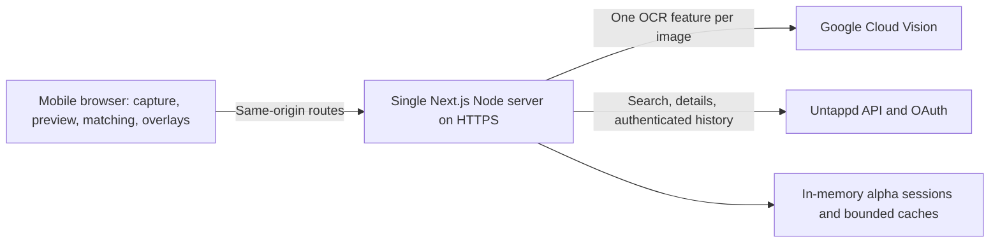

# Arntappd: roadmap for rebuilding a testable alpha

**Status: implementation specification; the application must be rebuilt.**

**Last reviewed: October 17, 2026.**

**Repository:** <https://github.com/jeffpaul/arntappd>

This document preserves the product decisions and technical approach from the
original project conversation so a new developer or coding agent can start
without that conversation. It specifies behavior, implementation order,
verification, deployment, and the boundary between the alpha and later work.
It does not claim the earlier application source has been recovered.

## Contents

1. [What exists, what was lost, and how to restart](#1-what-exists-what-was-lost-and-how-to-restart)
2. [Product goal and agreed decisions](#2-product-goal-and-agreed-decisions)
3. [MVP boundary and the user journey](#3-mvp-boundary-and-the-user-journey)
4. [Ratings, counts, missing data, and recommendation semantics](#4-ratings-counts-missing-data-and-recommendation-semantics)
5. [Architecture and repository layout](#5-architecture-and-repository-layout)
6. [Image capture and OCR](#6-image-capture-and-ocr)
7. [Menu parsing, beer matching, and overlays](#7-menu-parsing-beer-matching-and-overlays)
8. [Untappd integration and OAuth](#8-untappd-integration-and-oauth)
9. [Application contracts and UI state](#9-application-contracts-and-ui-state)
10. [Privacy, security, costs, and operational limits](#10-privacy-security-costs-and-operational-limits)
11. [Implementation milestones and Git checkpoints](#11-implementation-milestones-and-git-checkpoints)
12. [Verification and alpha acceptance](#12-verification-and-alpha-acceptance)
13. [Render deployment and owner handoff](#13-render-deployment-and-owner-handoff)
14. [Troubleshooting and open technical questions](#14-troubleshooting-and-open-technical-questions)
15. [Post-MVP roadmap](#15-post-mvp-roadmap)
16. [Restart instructions for a developer or coding agent](#16-restart-instructions-for-a-developer-or-coding-agent)
17. [References and evidence status](#17-references-and-evidence-status)

## 1. What exists, what was lost, and how to restart

### 1.1 Current source status

The earlier work was described as being in `/workspace/arntappd`. It was not
committed to the repository. After the environment was restored, that
application source was absent. The available Git history contains the original
`.gitkeep` commit and the subsequently pushed backlog/documentation commits.

Checks of the current workspace, available Git objects, refs, and reflogs found
no application commit. The owner supplied `arntappd.zip`; it contains `.gitkeep`
and Git metadata for the same initial commit
`b1d919f2abc7ef1bb44c192184944402cbc1fcf5`, with no application files or tests.
No archive hooks were executed. The available tools do not expose retrieval of
an older platform filesystem snapshot. This establishes that the source is not
recoverable from the copies available here; it does not prove no other copy
exists outside this environment.

As of this roadmap, the repository preserves documentation, 15 issue bodies,
a manifest linking them to GitHub, and an issue publishing helper. It is not a
runnable Next.js application. Commands later in this document describe the
**target rebuilt repository**, not commands that already work in this checkout.

The owner has requested this restart roadmap. Rebuilding from this specification
is the working path unless an actual source snapshot becomes available. If one
appears, inspect it in a separate directory, preserve it before changes, compare
its behavior with this specification, and validate it anew.

### 1.2 Evidence must be kept separate

| Evidence | What can be concluded |
| --- | --- |
| Current committed repository and uploaded ZIP inspection | The application source is missing from the available copies. |
| Existing GitHub issues #1–#15 | The backlog exists and is divided into MVP and post-MVP work. |
| Historical conversation reports | Useful implementation notes and test targets; they cannot reproduce a build without source. |
| New checks performed during a rebuild | Evidence for the rebuilt app only, recorded with commit, environment, and date. |

Historical reports described 9 unit tests, 4 browser tests, a passing typecheck
and production build, a labeled sample menu, and successful live OCR/search/
confirmation for three beers. They also explicitly left physical iPhone capture
and interactive Untappd personalization unverified. Do not copy those test
counts or results into a new release report as if the rebuilt code passed them.

Reported live results on October 10, 2026 included these beers:

| Beer | Untappd beer ID | Reported display rating |
| --- | --- | --- |
| Goose Island Bourbon County Brand Bananas Foster Stout (2023) | `5462530` | `4.24` |
| Russian River Pliny the Elder | `4499` | `4.49` |
| Allagash White | `5862` | `3.75` |

Those are historical observations, not current API assertions. Confirm IDs and
current values again. Do not make live tests depend on an exact changing score.

### 1.3 Start in this order

1. Build a deterministic, labeled sample experience and commit it.
2. Deploy that sample to a real HTTPS host and test it on the iPhone before
   adding every integration. This proves the hosting and device path early.
3. Add manual Untappd search and beer details.
4. Add camera/library capture, OCR, and explicit match confirmation.
5. Add Untappd sign-in and carefully scoped personal/friends data.
6. Evaluate real menus, enforce the alpha safeguards, and record acceptance.
7. Keep small, validated checkpoints in GitHub throughout.

This sequence is more useful than building an entire app in an uncommitted
workspace and discovering deployment or phone limitations at the end.

## 2. Product goal and agreed decisions

### 2.1 The problem

At a restaurant, bar, bottle shop, or similar venue, a person wants help deciding
which beer to order. Arntappd should attach relevant Untappd information to beer
names in a photographed drink menu. It should help answer:

- Which beers have I never tried?
- Which beers have I tried and liked or disliked?
- What have my friends liked or disliked?
- What is broadly well rated, and how much data supports that rating?

The name means “AR Untappd.” The alpha uses a static photo with overlays; live
camera tracking is a later milestone. Avoid describing the alpha as live AR.

### 2.2 Decisions already made by the owner

| Topic | Agreed direction | Consequence for the rebuild |
| --- | --- | --- |
| Delivery | Mobile web first, supporting iOS and Android | One responsive web app; no native app or app-store release required. |
| Initial physical tester | iPhone 17 | Safari camera/library behavior on the real phone is a release gate. |
| Capture | Still-photo capture/upload first | Camera preview/tracking and frame-by-frame recognition are out of MVP. |
| Drinks | Beer first | Do not add wine, cocktails, or generic drink recognition to the first release. |
| Data source | Untappd API | Use approved API capabilities; website UI does not prove API availability. |
| Personalization | Encourage Untappd login | Signed-out global exploration remains useful, with a clear sign-in path. |
| Uncertain matches | Show up to three likely candidates | Let the person select, search manually, or remove an OCR line. |
| Photo processing | Reliable and cost effective | Begin with Google Cloud Vision, measure actual menu accuracy and cost. |
| Initial hosting | Render is the current choice | Railway was rejected because setup was confusing; do not repeat that setup. |
| Future targets | Store shelves and tap handles | Preserve this intent, but treat recognition/localization as separate research. |
| Working style | Plan and involve the owner in material decisions | Routine implementation can proceed; revisit real API/product tradeoffs explicitly. |

The owner has already registered an Untappd application and supplied Untappd and
Google credential bindings in the cloud environment. Google Cloud Vision was
enabled during the earlier work. Reuse existing bindings if still usable; verify
status without printing values. Credentials do not automatically transfer to a
deployment provider.

Do not ask the owner to choose mobile web versus native, beer versus all drinks,
or photo versus live camera again unless a new constraint changes that choice.

## 3. MVP boundary and the user journey

### 3.1 Required for an invited alpha

- A reachable HTTPS URL that opens on the owner's iPhone.
- A labeled sample menu that works without API credentials.
- Separate “Take photo” and “Choose photo” entry points where supported.
- A preview and clear consent before sending a menu photo to Google.
- Text extraction with positions, editable/reviewable beer-name suggestions,
  and useful empty/error states.
- Up to three candidates per recognized beer, with brewery/vintage context,
  manual search, removal, and explicit confirmation.
- Photo annotations and an equivalent accessible list view.
- Current global Untappd ratings and count semantics after confirmation.
- Untappd sign-in and verified personal/friends context, within documented API
  coverage. If a required aggregate cannot be obtained, explain the limitation
  and have the owner assess the fallback before claiming full personalization.
- Sorting/filtering that helps answer the ordering questions without inventing
  missing history or treating popularity as the same thing as quality.
- Safe handling of credentials, transient photo processing, reasonable request
  budgets, and a repeatable tester checklist.

### 3.2 Excluded from MVP

Live camera tracking; WebXR; native iOS/Android builds; shelf/product segmentation;
logo-only tap identification; automatic ordering or check-ins; venue inventory
sync; wine/cocktail support; a broad social feed; recommendations trained on
private history; multiple server replicas; and a public, unlimited launch.

The public Untappd API documentation explicitly says venue beer/tap lists are
not supported. Photographing a menu is therefore an intentional input method,
not a temporary substitute for an assumed venue-list API.

### 3.3 Main flow

1. Open Arntappd. See the purpose, sample option, capture/upload choices, and
   Untappd sign-in state.
2. Optionally try the sample. Every sample result remains visibly labeled as
   demo/illustrative data.
3. Sign in if personal context is wanted. A signed-out person can still use
   supported global search/ratings.
4. Capture or choose a menu photo. Keep it local until the person confirms
   processing. Explain that the image will be sent to Google for recognition.
5. Normalize and preview the image. Allow replacement/cancellation.
6. Scan once. Show progress and let the person recover from failure without
   having to restart the entire flow.
7. Present recognized lines and candidates. Show the corresponding image
   region when reviewing a line. Do not silently confirm a candidate.
8. On selection, fetch current beer information and display rating context.
9. Switch between photo and list, sort by available ratings, and inspect
   details or open the beer on Untappd.
10. Start another scan, correct a match, or sign out.

Signing in must not silently discard the current photo or confirmed choices.
Choose an explicit policy: keep them in tab memory where navigation allows, or
use short-lived, consented tab-local storage for the normalized photo and scan
state. Do not put image bytes or tokens in OAuth URLs. Clear any temporary
storage on reset/expiry. If the first alpha cannot preserve a scan through the
OAuth redirect, explain before leaving and encourage sign-in before scanning.

### 3.4 Product details that matter

For a selected beer, a compact card might show:

```text
Bourbon County Brand Bananas Foster Stout (2023)
Goose Island Beer Co.
You (0): —  ·  Not tried
Friends: 4.05  ·  10 recent check-ins
Global: 4.21  ·  17.1k check-ins
```

This illustrates layout and meaning; the values are not live API output. The
owner's original screenshot used “You (0): 0.00,” “Friends (10): 4.05,” and
“Global (17.1k): 4.21.” Prefer a dash plus an explicit untried/unrated state when
there is no rating, so absence is not mistaken for disliking a beer. If exact
visual parity with the screenshot is desired, confirm that presentation choice
without changing the underlying missing-data semantics.

Show the separate number of ratings contributing to an average in expanded
details when available. Use readable touch targets and sufficient contrast;
color may reinforce a state but cannot be its only indication.

## 4. Ratings, counts, missing data, and recommendation semantics

### 4.1 Count definitions

| Field | Intended meaning | Important caveat |
| --- | --- | --- |
| Your check-ins | Your total check-ins for this beer, if the API supplies an exact aggregate | A list of recent activity is not automatically your lifetime total. |
| Your rating | Your API-provided rating/aggregate, with its semantics verified | Do not assume a field is an average across all your check-ins. |
| Friends' check-ins | Matching rated/unrated entries within the loaded friends feed | Count check-ins, not unique friends; disclose the recent/bounded scope. |
| Friends' average | Mean of valid ratings among those matching entries | Exclude unrated entries; do not invent a historical all-friends average. |
| Global check-ins | Provider total check-ins, when available | This is different from the number of ratings used in the average. |
| Global average | Provider's `rating_score`, after validating the response contract | Do not recalculate the global score from a sampled activity feed. |
| Global rating count | Provider's `rating_count`, when available | Label it “ratings”; do not relabel it “check-ins” as a silent fallback. |

Use separate fields for check-in count, rating count, and unique people. If
only rating count is available, display that count with its correct label.
Do not substitute it under a check-in label to make a card look complete.

### 4.2 Explicit states

| Situation | Correct behavior |
| --- | --- |
| Signed out | Show global context; invite login for personal/friends context. |
| Personal history fully exhausted and beer absent | It is valid to say “Not tried” / “New to you.” |
| Personal history truncated and beer absent | Say “Not found in loaded history,” with unknown overall status. |
| Check-in exists but no rating | Say “Checked in, not rated”; do not render a dislike score. |
| Friends have no matching loaded check-ins | Say no matching recent activity / unavailable, not zero stars. |
| Global beer has no ratings | Show unrated and an appropriate count, not a zero-star judgment. |
| Provider unavailable or quota exhausted | Show unavailable/stale context explicitly; keep match correction usable. |
| Sample mode | Show demo labels and fixture values; never masquerade as current provider data. |

Confirm Untappd's actual unrated representation from sanitized responses.
Do not infer that a numeric `0` is a genuine rating or an unrated sentinel without
checking the endpoint's convention. Preserve genuine low ratings when valid.

### 4.3 Proposed internal metric model

The following describes a target contract, not recovered implementation:

```ts
type Coverage = "complete" | "partial" | "unavailable" | "signed_out";

type Metric = {
  average: number | null;        // valid 0..5 only when the source defines it
  checkinCount: number | null;
  ratingCount: number | null;
  coverage: Coverage;
  scope: "personal" | "friends_recent" | "global";
  fetchedAt: string | null;      // ISO timestamp
  explanation: string | null;   // safe, human-readable coverage explanation
};

type PersonalExperience =
  | "untried_confirmed"
  | "tried_rated"
  | "tried_unrated"
  | "unknown"
  | "signed_out";
```

Add validation invariants in code: an average cannot exist with zero contributing
ratings when that count is known; untried-confirmed requires complete coverage;
unknown counts stay `null`; values must be finite and in range. Adapters should
encode endpoint-specific semantics once, rather than scattering assumptions
through UI components.

### 4.4 Filtering and ranking

- “New to me” includes only confirmed-untried beers. Offer “Unknown history”
  separately rather than merging the two states.
- “My highest rated,” “Friends' highest rated,” and “Global highest rated” sort
  by their corresponding available averages; unavailable values go last.
- Show sample size and friends coverage with each result.
- Use stable tie-breaking so cards do not jump unpredictably.
- Do not call a beer “popular” solely because its average is high. Popularity
  may mean check-in volume; expose that separately if offered.
- An optional personal “liked” threshold is a product preference. Use sorting
  first; do not silently assume everybody's cutoff is 4.0.

## 5. Architecture and repository layout

### 5.1 Recommended alpha architecture

Use one Next.js/React/TypeScript app on one persistent Node.js server. The
browser handles capture, preview, normalized photo display, and interactions.
Server routes handle provider credentials, OCR requests, Untappd calls, OAuth,
and temporary sessions/caches. Use `sharp` on the server for safe decoding and
normalization. Native image processing is a reason to begin on a Node host
rather than migrate directly to a restricted worker runtime.



No database or object-storage bucket is required for this alpha. Session state
is lost on restart; document this and test it. Multiple processes, replicas,
serverless functions, or worker hosting require shared secure state and shared
quota enforcement before adoption. Do not run a cluster of Node workers while
assuming an in-memory map is shared.

### 5.2 Runtime and dependency choices

The earlier design used Node 24.1+, Next.js 16.4, React 19.3, TypeScript,
`sharp`, and Playwright. These are historical choices, not a recovered lockfile.
At rebuild time choose currently supported, mutually compatible releases,
check security advisories and hosting support, and pin them with a committed
lockfile. Do not assert historical versions are the best current versions.

Node 24 LTS is a reasonable target if supported by the chosen host. The earlier
cloud environment needed Node's environment-proxy support to use its injected
credentials. Verify the exact Node flag/API and version before adding it to
scripts; a normal external deployment may have no proxy at all. Preserve TLS
verification.

For Next.js, read the installed version's documentation. In particular, verify
route handlers, async cookie APIs, runtime selection, upload handling, build
behavior, and native-module packaging. Do not force every route to an edge
runtime when server code imports `sharp` or Node crypto.

### 5.3 Suggested file structure

```text
README.md                         Working setup and known limitations
ROADMAP.md                        This rebuild plan
package.json / package-lock.json  Exact dependencies and commands
.nvmrc or .node-version            Runtime pin consistent with the host
.env.example                      Names/placeholders only
.gitignore                        Secrets, build output and caches excluded
next.config.ts                    Required app/runtime/security configuration
render.yaml                       Validated deployment configuration
public/sample-menu.svg            Generated, non-sensitive sample image
src/app/page.tsx                   Main experience
src/app/layout.tsx
src/app/globals.css
src/app/api/health/route.ts        Cheap liveness check; no paid provider call
src/app/api/status/route.ts        Safe configuration/account status
src/app/api/scan/route.ts          Bounded image upload and OCR
src/app/api/search/route.ts        Beer candidates
src/app/api/beer/[id]/route.ts     Confirmed-beer data
src/app/api/auth/login/route.ts
src/app/api/auth/callback/route.ts
src/app/api/auth/logout/route.ts
src/components/                   Capture, scan review, cards, overlays, list
src/lib/types.ts                  Normalized domain contracts
src/lib/menu.ts                   Word grouping / line extraction
src/lib/matching.ts               Query normalization and ranking
src/lib/overlays.ts               Placement and fallback rules
src/lib/demo.ts                   Explicit fixtures
src/lib/server/vision.ts          Google adapter, server-only
src/lib/server/untappd.ts         Untappd adapter, server-only
src/lib/server/session.ts         OAuth session storage, server-only
src/lib/server/budgets.ts         Request and concurrency limits
src/lib/server/errors.ts          Safe errors and provider response handling
src/lib/server/config.ts          Validated environment access
scripts/                         Optional setup/deployment helpers
tests/                            Unit and browser integration tests
docs/validation/                  Results and manual test records
```

Keep pure parsing/ranking/placement functions separate from provider calls so meaningful tests do not require keys.
Use a server-only import boundary to prevent credential-bearing modules from
entering the browser bundle.

### 5.4 Session/cache boundaries

For the alpha, use opaque, cryptographically random session IDs in browser
cookies; map them server-side to tokens and minimum required account fields.
Use a bounded global process store that survives development hot reload where
appropriate, with explicit expiry and cleanup. Avoid keeping photos there.

Cache public beer details by beer ID with bounded size/TTL. Cache personal and
friends data by the authenticated account/session; do not serve one person's
history to another. A proposed five-minute history TTL is a starting point,
not a provider freshness guarantee. Keep auth-scoped responses private and
uncacheable by shared CDNs. Match/search caches need consistent normalization
and must respect provider terms.

## 6. Image capture and OCR

### 6.1 Provider choice and cost experiment

Start with Google Cloud Vision `TEXT_DETECTION`, the earlier approach reported
as successful on a controlled menu. It returns word bounding polygons needed
for positioning. Also evaluate `DOCUMENT_TEXT_DETECTION` on dense/multicolumn
menus; Google describes its response as optimized for documents and dense text.
Choose one based on measured extraction and grouping quality. Do not send every
production photo to both features merely to compare them.

Google's pricing page reviewed for this roadmap lists the first 1,000 monthly
units free for each listed text-detection feature, then $1.50 per 1,000 in the
initial paid band. Confirm current SKU/currency/project billing before release.
A feature applied to an image is a billing unit; combining features or retrying
can increase usage. Hosting is a separate cost.

A browser-only OCR library could reduce provider calls but adds downloaded
models, mobile CPU/memory use, and accuracy tradeoffs. Do not switch to it only
because its API price is zero. A general multimodal model may help with labels
later; do not replace deterministic beer lookup with invented beer IDs or
rating values. Select alternatives using the same labeled evaluation set.

### 6.2 Browser capture and normalization

1. Provide a camera-oriented file input (for example, an environment-facing
   capture hint) and a separate photo-library input. Treat capture attributes
   as browser hints, not guarantees of a particular camera UI.
2. On file selection, validate basic type/size and preview the local image.
   File `accept` attributes are not server validation.
3. Explain what leaves the device, then require the person's scan action.
4. Decode and normalize orientation once. Test Safari behavior with real
   portrait/landscape and HEIC-origin images; do not assume desktop JPEG tests
   establish iOS compatibility.
5. Preserve aspect ratio; propose a longest side of 2,200 pixels and JPEG
   quality around 0.85–0.90 as an initial measured tradeoff. Ensure small beer
   names remain readable. Avoid enlarging small photos.
6. Re-encode without retaining unnecessary EXIF/location metadata.
7. Keep the exact normalized image used for OCR as the reference displayed
   under the overlay. Return dimensions/geometry sufficient to map coordinates
   if server normalization changes it.
8. Revoke old object URLs, cancel stale requests, and clear old scan state when
   replacing a photo. Avoid retaining multiple full-size bitmaps in memory.

Safari can sometimes supply a converted image even if the library original is
HEIC. Verify the actual bytes delivered. If unsupported bytes arrive, provide
conversion guidance or implement a measured supported conversion path; do not
send undecodable data downstream and display an unexplained generic failure.

### 6.3 Server input boundaries

Proposed alpha limits, to verify against current Google and host limits:

| Boundary | Initial target | Reason |
| --- | --- | --- |
| Normalized photo upload | At most 10 MiB | Bound network and memory use. |
| Multipart request body | At most 11 MiB including overhead | Enforce while streaming, before unrestricted multipart buffering. |
| Decoded source | At most 40 megapixels | Limit decompression bombs and native decoder memory. |
| OCR dimensions | Longest side about 2,200 pixels | Control OCR/image cost while preserving menu text. |
| OCR feature requests | One per deliberate scan | Avoid charging per recognized line. |
| OCR concurrency | One or a small bounded queue per instance | Limit peak memory and repeated provider requests. |

The limits are application targets, not statements about the providers' current
maximums. Check all upstream/downstream limits independently. A JPEG whose
compressed size fits may still decode to excessive memory.

Validate magic bytes/actual decoding, not just the filename or MIME header.
Accept only intentionally supported raster formats. Do not accept arbitrary
image URLs and fetch them server-side; that adds SSRF and privacy problems.
Configure `sharp`'s input pixel limit before decode, normalize safely, and catch
errors without returning native diagnostics to the client. A payload limit that
only checks `File.size` after unbounded `formData()` is insufficient.

### 6.4 OCR request and response adapter

Send one request to:

```text
POST https://vision.googleapis.com/v1/images:annotate
```

Use the server-held Google credential through the supported authentication
mechanism, such as an API key header where supported, and a finite timeout.
For inline image requests, base64 encode only inside the server-provider
request. Avoid base64 copies in the browser's React state.

For `TEXT_DETECTION`, the first `textAnnotations` item represents the combined
text; use the following word entries for spatial grouping. Normalize omitted
zero coordinates to `0`: Google's documentation explicitly notes that zero
coordinate values may be absent from JSON. Empty `textAnnotations` means no
text, not necessarily a failed HTTP request. Inspect per-image `error` inside a
successful HTTP response as well as top-level status.

Keep a provider-neutral word representation:

```ts
type NormalizedRect = { x: number; y: number; width: number; height: number };
type OcrWord = {
  text: string;
  polygon: Array<{ x: number; y: number }>; // normalized to image size
  confidence: number | null;              // only if supplied for this feature
};
```

`TEXT_DETECTION` does not guarantee a usable confidence score for every word.
Keep confidence unknown when absent; do not synthesize a provider confidence
value from a candidate's popularity or search order.

## 7. Menu parsing, beer matching, and overlays

### 7.1 Parse the menu in spatial order

Do not treat every recognized text line as a beer, or flatten a multicolumn menu
into one string. Implement pure, testable steps:

1. Normalize word polygons, dimensions, text and omitted coordinates.
2. Estimate local text height and group words into candidate baselines using
   vertical overlap/tolerance. Account for modest camera skew.
3. Split rows at meaningful horizontal gaps so columns do not merge.
4. Order words within each segment and form line bounds.
5. Classify likely headings, prices, descriptions, brewery context and beer
   lines. Preserve the original string/position for user correction.
6. Associate adjacent brewery context carefully; never carry a brewery label
   across an unrelated column without evidence.
7. Remove obvious standalone prices, sizes and ABV from lookup queries without
   deleting meaningful numbers, beer names or a vintage such as `2023`.
8. Produce reviewable line items with a normalized rectangle, original text,
   cleaned query, and uncertainty notes.

Test examples such as “Bourbon County … 2023  $18,” “Pliny the Elder 8%  10oz,”
multiple beers on one horizontal row, wrapped beer names, and names that contain
numbers. Avoid aggressive heuristics that make manual recovery impossible.

### 7.2 Match pipeline

For each selected recognized line:

1. Search Untappd with brewery + beer name when available; the official docs
   recommend this query form.
2. Keep numeric Untappd beer IDs as identity, not a normalized display string.
3. Rank candidates using name similarity, brewery agreement, explicit vintage,
   and optional style/ABV context when reliable. Penalize conflicting vintages.
4. Return at most three candidates with enough distinguishing context to pick
   the right one. A high global check-in count is at most a tie-breaker.
5. Always require confirmation in the initial alpha. Label a suggested best
   match as a suggestion, not an already selected beer.
6. Fetch current detail/statistics only when needed for confirmation/display;
   deduplicate requests for repeated beer IDs.
7. Let the person edit the query, search again, select the right candidate,
   change an earlier selection, or remove a non-beer line.

An application ranking score is not a calibrated probability. Do not show
“98% certain” unless calibration against a labeled set establishes that claim.
A “No reliable match” state is preferable to a plausible but wrong beer.

### 7.3 Large menus and request coverage

The earlier proposal searched the first 12 recognized beer lines serially. Use
that as an initial budget cap, not an invisible menu-size limit. Tell the person
how many lines were recognized, how many have been searched, and which remain.
Let them choose further lines or use manual search. Keep headings out of this
budget where possible.

Do not fire parallel searches for every OCR token. Debounce manual input, cancel
obsolete UI requests, and use bounded provider concurrency. An abort in the
browser does not necessarily cancel an already-sent paid upstream request.
Only explicit retries should repeat a completed scan.

### 7.4 Anchor and callout behavior

Use normalized coordinates in the same canonical image space that OCR saw.
For an image drawn inside a container with `object-fit: contain`, use its actual
drawn dimensions and letterbox offsets, not the full container dimensions.
Preserve the mapping when the phone rotates or the viewport changes.

A practical alpha design is numbered anchors near the beer text plus nearby
compact callouts. Match numbers connect the photo and list. Collision handling
should keep labels inside the photo viewport, avoid covering the line being
identified, and avoid associating a callout with the wrong neighboring beer.
A simple layout strategy can try right, left, below, then above, choosing the
first valid nonoverlapping placement. It must have a failure path.

If there is insufficient room, keep the anchor and show the details in the list.
Say that additional results are in List. For crowded menus, opening in List is
reasonable; the exact cutoff should follow device testing rather than a claim
that every photo can fit all statistics. All confirmed beers must remain
reachable even when their full cards do not fit on the photo.

## 8. Untappd integration and OAuth

### 8.1 Verified documentation constraints

The official public API documentation was accessible when this roadmap was
prepared. It specifies:

- API base `https://api.untappd.com/v4`; HTTPS is required.
- A nonstandard app-identifying `User-Agent` on server API requests, including
  authentication calls. Example: `Arntappd/0.1 (beer-menu discovery)`.
- Unauthenticated API requests use both `client_id` and `client_secret` as query
  parameters; authenticated requests use `access_token` instead.
- The documented default rate limit is 100 calls per hour per app key; with
  authentication it is applied per user. Actual response headers and app
  entitlements must be checked.
- `X-Ratelimit-Limit` and `X-Ratelimit-Remaining` expose budget information.
- Venue/tap-list data is not part of the public API.

Query-string credentials are a provider constraint. Centralize the adapter and
redact the complete upstream URL from logs/errors/traces. Do not give the
browser a credential-bearing upstream URL to call directly.

### 8.2 Endpoint plan

| Purpose | Documented endpoint | Implementation note |
| --- | --- | --- |
| Search candidates | `GET /v4/search/beer?q=...` | Brewery + beer name; validate returned items, request limit and offset. |
| Current beer details | `GET /v4/beer/info/BID` | Verify global fields and compact mode in sanitized payloads. |
| Current account | `GET /v4/user/info/` with token | Document says the username may be omitted for the authenticated account. |
| Personal distinct beer history | `GET /v4/user/beers/USERNAME` or authenticated omission | Offset pagination; documented max page size 50. |
| Friends' activity | `GET /v4/checkin/recent` with token | Friend check-ins only; max page size 50, ID-based pagination. |

The documentation's endpoint descriptions do not establish every response
field's semantics. Capture sanitized representative responses in a private
validation environment, then create minimal non-sensitive test fixtures. Verify
where check-in counts and personal rating aggregates actually live. Do not ship
an adapter based on an assumed object shape.

For global details, historical code notes named `beer.rating_score`,
`beer.rating_count`, and `beer.stats.total_count`. Treat them as fields to verify
against the current response, not proof every beer always supplies them.

### 8.3 Personal coverage

A proposed first implementation loads up to 200 distinct beers, in pages of at
most 50, and caches them briefly in the session. This bounds API usage but does
not promise lifetime coverage for a prolific user.

Track `loadedItems`, the next page/offset, whether the upstream list is fully
exhausted, the configured cap, and fetch time. Validate pagination termination
using documented metadata/actual responses rather than assuming a cap boundary
means completion. Only complete coverage can prove absence. If a beer is found,
verify whether its aggregate is exact even though the overall list is partial.
Do not derive a lifetime check-in total from the number of distinct beer rows.

Before finalizing this approach, investigate whether the approved API offers a
more direct per-beer user aggregate. If it does, compare accuracy and budget. If
it does not, preserve explicit unknown states and document the limitation.

### 8.4 Friends' context

A proposed first implementation examines up to 100 recent friend check-ins,
using at most two full 50-item pages if supported. Dedupe overlapping pages by
check-in ID. Group confirmed beer IDs, count matching check-ins, and average
only ratings established as valid by the provider contract. Multiple check-ins
from one person remain multiple check-ins; do not label the count “friends.”

No matching entries in that feed does not mean no friend ever tried the beer.
Always label the section as recent activity, disclose coverage, and do not claim
parity with the website's historical Friends number. The owner wants the broader
context; API availability is a product risk to validate early, not hide late.

### 8.5 Server-side OAuth sequence

1. `GET /api/auth/login`: validate the canonical app origin, generate strong
   random one-time state, store it with a short TTL, and redirect the browser
   to the provider authorization page.
2. Use Untappd's documented server-side flow:
   `https://untappd.com/oauth/authenticate/` with `client_id`,
   `response_type=code`, `redirect_url`, and `state`.
3. Register the exact callback
   `https://<app-origin>/api/auth/callback` in Untappd API Central.
   Untappd uses the parameter name `redirect_url`; do not silently substitute
   another OAuth provider's `redirect_uri` convention.
4. On callback, handle denial/errors, require matching state, consume it once,
   and reject missing/expired/replayed state before token exchange.
5. Exchange the code server-side using the provider's documented
   `https://untappd.com/oauth/authorize/` endpoint and required parameters.
   Verify the current method/contract. Use the app-specific User-Agent and do
   not expose the request URL or token response in logs.
6. Fetch minimum account information, generate a new random session ID, store
   the token server-side, and set an opaque cookie. Never reuse OAuth state as
   the session ID.
7. Redirect to a clean app URL so authorization codes are not left in the
   address bar. Avoid logging the inbound callback query as well.
8. On sign-out, delete the server-side session and clear the cookie. Deleting
   an app session is not the same as revoking the provider token; document any
   supported provider revocation separately.

The browser navigation to Untappd uses the browser's own User-Agent. Set the
custom header on server-originated API/token requests; do not claim a redirect
allows the app to replace Safari's User-Agent. Test the provider's actual login
behavior interactively.

Use HttpOnly, SameSite=Lax, path `/`, and Secure cookies on production HTTPS.
A proposed 24-hour Arntappd session TTL is independent of the provider token's
lifetime. The docs currently describe non-expiring tokens; still handle revoked
or rejected tokens and require sign-in again. If a return path is supported,
allow only safe same-origin relative paths to prevent open redirects.

### 8.6 Budget arithmetic

A proposed local guard of 85 calls/hour per actual credential scope leaves
headroom below the documented default, but must respond to real provider
headers and other app traffic. Authenticated and application-key budgets are
separate. A per-session counter alone does not enforce a per-user budget if the
same user has several sessions.

For example, 12 searches + 12 detail fetches + 4 personal pages + 2 friends pages
+ 1 account request is 31 API calls before retries and cache reuse. That can
consume much of an hourly budget after only a few uncached scans. Count OAuth
or other calls conservatively until their budget treatment is established.
Measure actual calls and reuse cached results rather than assuming this is
unlimited menu recognition.

Use a bounded cache, debouncing, serial/bounded searches, and a small retry
budget. Do not retry quota errors immediately. Treat missing reset headers as
unknown; do not invent a provider reset time from a local fixed-hour bucket.

## 9. Application contracts and UI state

### 9.1 Suggested same-origin routes

| Route | Input/output target | Side effects and safeguards |
| --- | --- | --- |
| `GET /api/health` | Minimal liveness/version response | No provider call, no auth requirement, cheap enough for host probes. |
| `GET /api/status` | Configured capability flags and safe current-account summary | Presence of variables means configured, not proven provider access. |
| `POST /api/scan` | Bounded multipart image → image dimensions, reviewable lines, warnings | Same-origin validation, consent flow, OCR quota and concurrency limit. |
| `GET /api/search?q=...` | Bounded query → up to three candidate summaries | Validate length; debounce and enforce the correct provider budget. |
| `GET /api/beer/[id]` | Numeric ID → identity, metric groups, coverage | Separate public and private caching; never expose tokens. |
| `GET /api/auth/login` | Redirect to Untappd | One-time state and optional safe return path. |
| `GET /api/auth/callback` | Provider code/state → clean app redirect | Validate state before exchange; safe errors. |
| `POST /api/auth/logout` | Empty payload → cleared session | Same-origin/CSRF safeguards. |

The scan route need not perform all beer searches in one long response. A
simpler design returns lines first; the client requests candidates through a
bounded queue. That makes partial results, manual corrections and request
coverage visible. If server orchestration is chosen instead, define how
partial successes and timeout recovery work. Do not leave an ambiguous promise
that a long scan request both mutates selection and guarantees all lines finish.

### 9.2 Proposed domain types

```ts
type BeerCandidate = {
  id: number;
  name: string;
  brewery: string;
  style: string | null;
  abv: number | null;
  vintage: string | null;
  untappdUrl: string;
};

type MenuLine = {
  id: string;                    // stable within this scan
  originalText: string;
  searchText: string;
  bounds: NormalizedRect;
  candidates: BeerCandidate[];    // 0..3
  selectedBeerId: number | null;
  state: "unsearched" | "searching" | "review" | "confirmed" | "removed" | "error";
  warning: string | null;
};
```

Treat this as a contract to refine with real payloads, not a complete model of
every loading/error combination. Ensure selection is separate from suggestion;
only a deliberate user action sets `selectedBeerId`. A manual entry may have no
photo bounds, so model it as a separate item variant or allow explicit absent
geometry instead of placing it at an arbitrary coordinate.

### 9.3 State transitions and stale response protection

Keep scan identity and request generation IDs. If the person replaces the
photo or edits a query while a request is in flight, the old response must not
replace the new photo's text or a newer candidate list. If they change a
confirmed beer, stale detail requests must not attach old statistics to the new
selection. Use cancellation plus response identity checks.

Capture states should distinguish: idle, local preview, normalizing, consented
upload, recognizing, no text, ready for review, and failed. Candidate and detail
states belong to each item so one failed beer does not erase the whole menu.
Support retrying one line and removing false-positive headings. Keep confirmed
items visible while another item is loading.

### 9.4 Errors and capability reporting

Use safe structured error codes such as `IMAGE_TOO_LARGE`, `IMAGE_UNSUPPORTED`,
`NO_TEXT`, `LOOKUP_UNAVAILABLE`, `PROVIDER_LIMIT`, and `AUTH_REQUIRED`, paired
with actionable messages. Distinguish app limits, provider quotas and transient
network failures internally. Return appropriate HTTP statuses, but do not
assume all provider failures are HTTP failures; inspect JSON error envelopes.

Status flags such as `ocrConfigured` and `untappdConfigured` must not be called
“verified live” simply because an environment variable exists. Live validation
belongs in an authenticated/operator check or a recorded smoke test, not an
expensive provider call on every public health request.

The sample remains available if credentials are missing. A live API error must
never silently switch a real photo to demo statistics.

## 10. Privacy, security, costs, and operational limits

### 10.1 Credentials and runtime configuration

| Name | Where used | Required handling |
| --- | --- | --- |
| `UNTAPPD_CLIENT_ID` | Server API/OAuth adapter | Keep configuration server-side; do not assume its presence means the secret works. |
| `UNTAPPD_CLIENT_SECRET` | Server API/token requests | Secret; never `NEXT_PUBLIC_*`, committed JSON, issue body or browser response. |
| `GOOGLE_VISION_API_KEY` | Server OCR adapter | Secret; enable/restrict to the intended Vision API and compatible server use. |
| `APP_BASE_URL` | Canonical origin and callback construction | Exact HTTPS origin in production, no path or trailing slash. |
| `PORT` | Host-provided server listen port | Read the host value; listen on `0.0.0.0`, not a loopback-only interface. |
| Optional `HTTPS_PROXY` / platform proxy configuration | Cloud development egress | Use the platform-supported route; never extract proxy-held credentials. |

Create `.env.example` with names and blank/non-secret examples only. Use the
host's private variables UI for deployment values. Some cloud credential
bindings are proxy placeholders that are replaced only at approved HTTPS
destinations. They cannot be copied as real keys into Render. The owner must
enter actual provider credentials through the deployment host's secure UI.

No Railway token is needed for the Render GitHub/Blueprint path. Render does
not need a GitHub personal access token pasted into chat. Start with its normal
GitHub connection scoped to this repository. Do not broaden credentials merely
because a CLI is not logged in.

For cloud development, the known outbound destinations include:

- `untappd.com` for OAuth and documentation.
- `api.untappd.com` for API calls.
- `vision.googleapis.com` for OCR.
- `cloud.google.com` and `docs.cloud.google.com` for reference material.
- `github.com` for the configured Git transport and `api.github.com` for issues
  and API operations. Git access and API access are distinct permissions.
- The actual Render documentation/dashboard/API and deployed app host as
  needed; add exact required destinations after inspecting the workflow.

A saved environment draft, a running process, a published snapshot, and a new
machine restoring that snapshot are different states. Verify each explicitly.
A draft does not prove secrets reached a process or files survived restoration.

### 10.2 Photo and account data handling

- Keep the menu image in the current browser flow and transient server memory.
  Do not persist it to disk, object storage, analytics, or Git as normal behavior.
- Tell the person Google receives the image for recognition. Arntappd's lack
  of persistence is not a promise about all provider retention or processing.
- Strip unnecessary metadata when normalizing; a menu photo can contain faces,
  names or background details, so avoid requesting more of the scene than needed.
- Store the minimum account/history information needed for the current session.
  Clear it on logout/expiry; document any browser-side scan persistence.
- Keep tokens out of localStorage, client bundles, screenshots and fixture data.
- Sanitize validation artifacts. Obtain permission before publishing real menu
  photos or user/friend data; private test evidence is preferable when uncertain.
- Derive or validate external beer links to approved HTTPS Untappd URLs. Do not
  turn arbitrary upstream strings into unsafe navigation targets.

### 10.3 Server defenses required for alpha

Validate canonical same-origin requests for state-changing routes. Do not trust
`Host` or a user-supplied origin to construct OAuth redirects. Limit request
body size before buffering, image dimensions, search query length, IDs,
concurrency, cache size, and session count. Reject unsupported methods.

Use strong randomness, one-time OAuth state, production cookie settings,
finite provider timeouts, controlled retries and safe error envelopes. Do not
return stack traces or upstream response bodies. Avoid logging full incoming
OAuth callback URLs or outgoing credential-bearing URLs. Check host access
logs and tracing as well as application `console` calls.

Apply sensible security headers and a restrictive referrer policy. Validate
any CSP against the actual Next.js build and image/beer-link behavior instead
of copying a header that breaks hydration. Secure cookies require the actual
HTTPS production path; localhost exceptions must remain development-only.

Do not assume an unlisted URL is an access control. For an invited alpha,
choose documented exposure and request caps. If a host-level access gate is
available and needed, test it with Untappd redirects and camera usage.

### 10.4 Spend controls

Proposed application caps: 30 OCR scans/hour per instance and 85 Untappd calls/
hour per credential scope, adjusted to actual entitlements and observed usage.
These are starting points for a small alpha, not durable billing guarantees.
Restarts reset in-memory counters; direct callers can reach a public API route
without using the UI. A larger release requires shared enforcement and abuse
controls.

Enable Google billing alerts and appropriate API quotas. A billing budget alert
is not a hard stop or guaranteed spending cap. Verify which request quotas can
be lowered and how quickly provider enforcement applies. Count retries and
any extra OCR features. Document the host's recurring cost and sleep behavior;
do not quote an old plan price as current without checking it.

### 10.5 What is deferred without hiding the risk

A single persistent instance and restart logout are acceptable for this owner's
alpha. Shared sessions, durable global quotas, richer monitoring and account
data deletion workflows become necessary before broader deployment or storage.
Keep a record of the limitation in the tester instructions. Do not silently
move the same memory-only code to multiple replicas or a worker platform.

## 11. Implementation milestones and Git checkpoints

These are build milestones, not estimates or a promise of one uninterrupted
coding session. Close issues only when their acceptance criteria are met.
The roadmap itself does not satisfy the source recovery/rebuild issue.

### Milestone 0 — Reproducible foundation and preserved source

**Primary issue:** [#1](https://github.com/jeffpaul/arntappd/issues/1).

- Confirm the current baseline and inspect repository instructions.
- Scaffold the chosen supported Next.js/React/TypeScript version.
- Pin Node/dependencies; commit the lockfile, `.env.example`, `.gitignore`, and
  minimum setup instructions. Verify native `sharp` installation.
- Add cheap `/api/health` and safe `/api/status` contracts.
- Establish install, development, typecheck, test, build and start commands.
  Use frozen-lockfile installation (`npm ci`) after creating the lockfile.
- Add meaningful pure-function/test infrastructure as actual functions appear,
  rather than inventing passing placeholder tests.
- Commit and push the foundation. Verify the remote commit and a fresh checkout
  outside the working tree. Preserve any unrelated owner files.

**Gate:** a fresh checkout can install, build and serve the basic page with the
specified runtime. Missing provider keys produce a safe configured/unconfigured
state. Source exists in GitHub, not only in a workspace snapshot.

### Milestone 1 — Deterministic sample experience

**Primary issues:** [#1](https://github.com/jeffpaul/arntappd/issues/1), later
[#7](https://github.com/jeffpaul/arntappd/issues/7).

- Create a generated menu image with three well-known beers and known line bounds.
- Implement identity, metric states, compact cards, detail view, list view,
  anchors and collision/fallback behavior.
- Implement sorting and confirmed-untried filtering with fixtures covering
  missing, partial, unrated and signed-out states.
- Label all demo/illustrative statistics. The first beer may use the owner's
  reference screenshot values, but those are static examples.
- Build responsive capture/sample entry UI and accessible match/detail dialogs.
- Commit and push the sample and its meaningful tests.

**Gate:** sample works with no credentials, no live provider requests, correct
missing-data semantics, no hidden results, and no mobile horizontal overflow.

### Milestone 2 — HTTPS deployment before full integration

**Primary issue:** [#2](https://github.com/jeffpaul/arntappd/issues/2).

- Verify current Render Node/Next.js/Blueprint requirements.
- Commit a supported deployment configuration and document the cost choice.
- Let the owner connect only this repository and approve the selected plan.
- Deploy one persistent Node service and generate its HTTPS address.
- Confirm host port binding, liveness, sample page and static assets.
- Open the actual URL on the iPhone 17; test navigation and sample controls.

**Gate:** the owner has a working sample URL. If native dependencies, build
memory, or plan limitations fail, fix them before implementing more providers.

### Milestone 3 — Manual beer search and current global details

**Primary issues:** [#1](https://github.com/jeffpaul/arntappd/issues/1) and
[#3](https://github.com/jeffpaul/arntappd/issues/3).

- Add centralized server-only Untappd adapter with app User-Agent and safe errors.
- Verify search/detail response contracts using the existing credentials.
- Add candidate ranking, three-choice review, manual correction and confirmation.
- Display global average with distinct check-in/rating counts and timestamps.
- Add cache/budget guards and safe quota/error handling.
- Configure deployment credentials privately and recheck from the deployed host.

**Gate:** a person can search a beer, choose the correct variant, and see current
provider details over HTTPS. This works without OCR and isolates lookup problems
from recognition problems. Commit before adding OCR.

### Milestone 4 — Camera/library photo to candidates and overlays

**Primary issues:** [#3](https://github.com/jeffpaul/arntappd/issues/3),
[#5](https://github.com/jeffpaul/arntappd/issues/5).

- Implement consented photo preview/normalization and bounded upload.
- Add Google Vision with response/error validation and spatial word extraction.
- Build/test multicolumn line grouping and query cleaning.
- Search selected lines within the visible request budget, retain manual recovery,
  and display only confirmed selections as identified beers.
- Map OCR coordinates to the canonical photo, with list fallback for dense menus.
- Verify no stale request can attach results to a replacement image or selection.
- Test camera/library/rotation/format handling on the physical iPhone.

**Gate:** a controlled three-beer photo completes the actual live browser flow,
then at least one real menu can be corrected and used. Record provider evidence
separately from intercepted browser tests. Commit and push.

### Milestone 5 — Interactive login and scoped personalization

**Primary issue:** [#4](https://github.com/jeffpaul/arntappd/issues/4).

- Register the deployment's exact callback and set `APP_BASE_URL`.
- Implement full server-side OAuth, cookie/session lifecycle and sign-out.
- Verify account, personal history pagination/completeness, and friend-feed
  aggregation using known examples and sanitized evidence.
- Show coverage everywhere it changes the meaning of “new,” ratings or counts.
- Handle denied login, expired state, revoked token and server restart.
- Resolve the scan-state-through-login policy from section 3.3.

**Gate:** interactive sign-in succeeds on the deployed app, known personal values
agree with provider results, friends scope is honest, and unknown history is
not misrepresented as untried. If the API cannot supply the wanted context,
bring the observed limitation to the owner before declaring this gate complete.

### Milestone 6 — Real-menu evaluation and invited-alpha release

**Primary issues:** [#6](https://github.com/jeffpaul/arntappd/issues/6),
[#7](https://github.com/jeffpaul/arntappd/issues/7).

- Evaluate at least five representative menu photos and record ground truth.
- Fix incorrect associations, confirmation traps, unreadable cards and broken
  error/retry states before adding more capture targets.
- Complete the acceptance checklist in section 12, including iPhone sign-in and
  physical capture. Record Android status honestly if only emulation was used.
- Verify provider quotas, secret handling, logs, privacy copy and plan behavior.
- Write simple tester instructions and a safe bug-report template.
- Tag or otherwise record the accepted commit and deployed version. Verify a
  clean checkout and the GitHub remote before handing it off.

**Gate:** the owner can independently open the URL, scan a real menu, correct
matches, inspect available personalized/global context, and report a problem.
All required unknowns are resolved or explicitly accepted as alpha limitations.

### Checkpoint discipline throughout

After each meaningful milestone, run the checks appropriate to the change,
commit the working source, and push within the session's authorized scope.
Record the resulting commit/branch and confirm it exists remotely. Use a branch
and review flow when required by repository policy. Do not force-push over
someone else's work or infer permission to merge a protected branch.

Before an environment publish/restore, confirm there are no unpreserved tracked
or untracked app files. `.gitignore` must not accidentally hide source. Runtime
processes, sessions, package caches and cloud snapshots are not substitutes for
committed source. If a push is blocked, preserve an explicit source archive or
patch outside the checkout, report the blocker, and verify the archive actually
contains application files; a ZIP of `.git` plus `.gitkeep` is not an app backup.

## 12. Verification and alpha acceptance

### 12.1 Target commands after the app is rebuilt

Choose scripts consistent with the actual framework/version; the intended
workflow is:

```sh
npm ci
npm run typecheck
npm test
npm run build
npm start
# In another terminal after confirming the server is ready:
npm run test:browser
```

Some cloud machines require a workspace-owned npm cache; use the repository's
working instructions rather than assuming the home cache is writable. These
commands are not currently available in the documentation-only repository.
A successful install or open port alone does not establish app readiness.

### 12.2 Meaningful unit/contract tests

| Area | Cases that can reveal real defects |
| --- | --- |
| OCR geometry | Missing zero coordinates, rotated/skewed boxes, two columns sharing a baseline, wrapped names. |
| Query normalization | Prices removed while beer numbers/vintages survive; brewery associations do not cross columns. |
| Candidate ranking | Same name/different brewery, same beer/different vintage, no reliable candidate, manual correction. |
| Metrics | Unrated versus low rating, partial history absence, repeated friend check-ins, check-ins versus rating count. |
| Pagination | Overlapping pages, caps, incomplete history, exhaustion and duplicate check-in IDs. |
| Quotas/caches | Credential-scope separation, repeat lookups, actual limit headers, cache expiry and bounds. |
| Overlay placement | Letterboxing/rotation, collisions, out-of-bounds cards, all results still in List. |
| Provider adapters | Empty, malformed, HTTP-error and nested-error responses; secrets excluded from safe errors. |
| OAuth/session | One-time/expired state, denial, safe return path, cookie flags, logout, revoked token. |
| Uploads | Body cap before buffering, unsupported bytes, excessive decoded dimensions, decoder errors. |

Do not write tests that merely mirror an implementation branch or assert a
fixture equals itself. Do not add trivial placeholder tests to achieve a count.
Record executed, skipped and unrun checks separately.

### 12.3 Browser integration tests

Use intercepted provider fixtures for deterministic UI behavior. Test sample
flow, consent, image upload, up to three candidates, manual search, selection
changes, missing data, filters, list/overlay parity, crowded photos, safe errors,
login-state UI and stale-response races. Include server checks for cross-origin
writes and invalid OAuth state.

Mobile Chromium/Playwright is useful but does not establish real iOS capture,
HEIC handling, Safari OAuth redirects or Android hardware behavior. Configure
browser-test origins to match framework development-origin policy. The earlier
work encountered a dev hydration failure with mismatched loopback hostnames;
fix the test origin rather than broadly disabling development safeguards.

### 12.4 Controlled live-provider test

1. Start the app on its canonical configured origin.
2. Confirm health and configured flags; do not confuse those with live access.
3. Search the reference beer and fetch its details with the real adapter.
4. Upload a generated three-beer menu through the real preview/consent flow.
5. Confirm the recognized lines/candidate IDs, then explicitly select each beer.
6. Compare global values with contemporaneous API results; allow values to change.
7. Complete actual Untappd sign-in and inspect known personal/friends examples.
8. Record network/provider outcomes without full URLs, keys, tokens or private
   payloads. Confirm the test did not intercept provider responses.

A successful controlled menu is one milestone, not proof of all menu accuracy.

### 12.5 Real-menu evaluation protocol

Use at least five photos as an initial diagnostic set: a simple printed list,
a multicolumn menu, a dense descriptions/prices menu, a low-light/glare example,
and a photo with similar names or vintages. Separate tuning photos from at least
some held-out examples; do not only measure the images used to create heuristics.

Annotate the expected beer identities and approximate text regions. Record:

- Number of actual beer lines and number extracted as usable suggestions.
- False-positive non-beer lines and merged/split/omitted beer lines.
- Correct candidate present among the top three, and correct top candidate.
- Wrong brewery/vintage associations and any falsely presented confirmation.
- Manual correction success and time/steps needed to recover.
- End-to-end latency, provider calls, OCR features billed, and UI failures.
- Overlay correctness and whether all results remain accessible in the list.

Report denominators; “four correct” has little meaning without the number of
actual lines. A five-photo set is an alpha diagnostic, not a statistically
representative benchmark. Establish any numerical accuracy/latency release
threshold with the owner after the baseline; do not invent an agreed target.

### 12.6 Minimum manual acceptance checklist

- [ ] HTTPS URL opens on the owner's physical iPhone 17 in Safari.
- [ ] Built-in sample is useful, visibly illustrative, and works without keys.
- [ ] Camera capture and library selection each work, including cancellation.
- [ ] Consent happens before sending the photo to Google.
- [ ] Portrait/landscape input produces correctly aligned text anchors.
- [ ] HEIC-origin/large/unsupported input has a tested usable path or clear error.
- [ ] Controlled photo yields expected candidates and explicit confirmation.
- [ ] Real menu items can be corrected, searched manually, changed or removed.
- [ ] Dense-photo results are all accessible in List; no misleading overlap.
- [ ] Live global averages and count labels agree with the provider.
- [ ] Untappd sign-in/callback, denial and sign-out work on that deployed origin.
- [ ] Known personal history is correct; unknown history is not called untried.
- [ ] Friends data is clearly recent/bounded and excludes unrated entries correctly.
- [ ] Sorting/filtering respects unavailable data and retains sample sizes.
- [ ] Errors, quota exhaustion and retries preserve useful scan state.
- [ ] No credentials/private photos appear in source, client responses or logs.
- [ ] Hosting cost/sleep behavior and restart logout are explained.
- [ ] Real-menu evaluation results and outstanding limitations are recorded.
- [ ] Source, lockfile, sample, tests and deploy configuration are on GitHub.
- [ ] Fresh-checkout verification and remote commit/version have been checked.

### 12.7 Evidence record

Use [the validation record template](docs/validation/TEMPLATE.md) for each
milestone/release. Include commit, deployed URL, runtime, device/browser,
date, fixture-versus-live status, command results, observations and unresolved
items. Store sensitive photos/account evidence privately and reference it
without publishing it. Never replace an unknown outcome with a historical
“passed” claim from the lost implementation.

## 13. Render deployment and owner handoff

### 13.1 Why this host is the current default

The alpha needs a persistent Node process, native `sharp`, HTTPS, private server
variables and outbound HTTPS to Untappd/Google. Render's Node web-service model
is the intended fit. Verify current Next.js support, Node versions, plan
eligibility, build resources and native dependencies before relying on it.

Railway was considered and rejected by the owner because its setup was too
confusing. Spacefast was also investigated: its documented Next.js deployment
uses a worker runtime, which would require checking native image processing and
moving sessions/quotas out of process memory. Do not switch hosts again as a
routine implementation choice; keep Render unless there is a demonstrated
blocker worth bringing to the owner.

Render documentation could not be fetched from this environment during roadmap
preparation because of the network policy. The following is a concrete target
runbook, not a claim that a Blueprint has been validated or a service deployed.
Review the linked current docs and test the configuration during milestone 2.

### 13.2 Deployment configuration to prepare

Commit a real `render.yaml` only when the application and commands exist.
A minimal illustrative starting point is:

```yaml
services:
  - type: web
    name: arntappd
    runtime: node
    plan: free
    buildCommand: npm ci --include=dev && npm run build
    startCommand: npm start
    healthCheckPath: /api/health
    envVars:
      - key: NODE_VERSION
        value: "24"
```

This example is not a validated schema or promise the free plan fits every
build. Verify the current syntax and available plans, select the agreed plan,
and pin the actual supported Node release consistently with the repository.
The free plan is an initial cost-conscious candidate; review idle sleep,
resource limits and restart behavior. Select paid/always-on hosting only after
the owner understands the current charge.

The application must use the host's `PORT`, listen on `0.0.0.0`, and run a
production build rather than `next dev`. Set production mode appropriately.
`npm ci --include=dev` is shown because TypeScript/build tooling may be in dev
dependencies; verify the build environment does not omit required tooling.
Do not make build success depend on live credentials or live provider requests.
Build-time static rendering should not attempt authenticated history lookups.

A minimal first deployment should serve the sample without integration values.
Add provider variables and canonical origin after its HTTPS address exists.
Do not put placeholder secrets into the deployment YAML. If later adding
`sync: false` entries to prompt for secrets, explain the prompts to the owner
and verify current Blueprint semantics.

### 13.3 Keep the owner's actions short

**Developer work before asking the owner to configure a service:**

1. Push working source, a validated deploy configuration, and basic instructions.
2. Verify a fresh local build/start and the proposed health path.
3. Provide the exact repository/branch/config file and current plan choice.
4. Tell the owner which screens/values remain necessary. Do not send them to
   create an empty service before the deployable source exists.

**Owner actions once that work is ready:**

1. Sign in to Render using GitHub and authorize only `jeffpaul/arntappd`.
2. Use the repository/Blueprint setup (often labeled **New → Blueprint**) and
   review the proposed one-service plan before applying it. Confirm current UI
   labels instead of guessing from an old screenshot.
3. Let the sample deploy, obtain the actual HTTPS address, and open it on the
   iPhone. Generated domains in this document are placeholders, not real links.
4. In the service's private environment variables, enter the actual existing
   `UNTAPPD_CLIENT_ID`, `UNTAPPD_CLIENT_SECRET` and `GOOGLE_VISION_API_KEY`.
5. Set `APP_BASE_URL` to the exact HTTPS origin, with no path/trailing slash.
6. In Untappd API Central, register
   `<APP_BASE_URL>/api/auth/callback` exactly; save and redeploy/restart where
   required by the host's variable update behavior.
7. Open the same canonical URL and complete actual Untappd authorization.

The developer then verifies provider calls, scans, current metrics and sign-in.
The owner never needs to paste credential values into chat, generate a broad
host token for the GitHub path, or guess start/build commands.

### 13.4 Deployment verification and rollback

After each deployment, confirm the deployed commit, healthy production process,
HTTPS asset loading, canonical-origin checks, sample flow, and representative
provider requests. Test sign-in again after changing the domain or callback.
Do not send an onboarding-loopback URL to the owner as a phone preview.

Record free-service cold-start behavior and whether restart clears sessions.
A health endpoint returning 200 does not prove OCR or Untappd works. Conversely,
a provider outage should not make a cheap liveness probe consume quota or
prevent the sample from loading.

Before release, record the last known-good commit/version and the host's actual
rollback action. A code rollback may not restore old variables or callback
registration; handle those separately. Never restore revoked credentials merely
to make an old build work. Recheck the critical flow after any rollback.

## 14. Troubleshooting and open technical questions

### 14.1 Lessons from the earlier setup

These are historical failure modes to diagnose, not claims that the rebuilt app
has the same errors:

| Symptom | Check first | Corrective direction |
| --- | --- | --- |
| Untappd rejects requests despite configured keys | Correct endpoint/auth parameters and app-specific User-Agent | Fix the central adapter; do not immediately request another key. |
| Google reports `API_KEY_INVALID` | Correct key/project and runtime propagation | Replace/fix through secure settings, then verify the affected request. |
| Google reports `SERVICE_DISABLED` | Vision API enabled in the key's project | Enable the actual API/project; a key alone is insufficient. |
| Google reports `API_KEY_SERVICE_BLOCKED` | Key API restrictions and server-compatible application restrictions | Allow the intended Vision service; browser-referrer rules may not fit server calls. |
| Key declared in configuration, app still sees missing value | Saved binding versus running process, restart and destination scope | Inspect presence/status only; verify propagation before duplicating credentials. |
| Cloud credentials work locally, Render fails | Actual host variables versus cloud proxy placeholders | Enter genuine values privately in Render; do not export placeholders. |
| OCR succeeds but returns no beer lines | Image quality, word grouping, heading filters, menu columns | Show recognized text/review options and manual entry; do not claim a match exists. |
| Wrong brewery/vintage | Query context and candidate ranking | Show distinctions and require confirmation; preserve meaningful numbers. |
| Overlay shifts after rotation | Canonical image geometry, EXIF handling and letterboxing | Use the same image coordinate space and recompute drawn bounds. |
| UI appears but controls do nothing in development | Hydration errors, test host/origin policy, browser console | Fix origin/configuration; do not broadly disable security rules. |
| Login returns to an error/loop | APP_BASE_URL, exact registered callback, state cookie, canonical domain | Compare actual HTTPS origin and parameter names; inspect safe error codes. |
| Login disappears after restart | Single-process in-memory sessions | Expected documented alpha behavior, or implement shared storage before scaling. |
| Intermittent sign-in across replicas | Multiple processes with independent session maps | Use one instance for alpha or implement shared state; sticky luck is not a fix. |
| Health is green but OCR is down | Health is only liveness; provider errors/quota are separate | Run a controlled live scan and inspect safe diagnostics. |
| Render build fails on native dependencies or memory | Runtime ABI, lockfile, build resources, supported framework configuration | Verify host support/resources; avoid unverified build flags or silent dependency changes. |
| Photo flow is slow after inactivity | Host cold start versus OCR/search latency | Measure stages separately and explain plan behavior before changing providers. |
| Git works but issues/API fail | Separate `api.github.com` network/auth permission | Test the specific API; do not assume a Git token or read permission covers all APIs. |
| Source vanishes after restore | Uncommitted/unpushed files versus retained snapshot | Check GitHub first; preserve source at each milestone, not only in environment storage. |

### 14.2 Questions to resolve with evidence during implementation

| Question | How to resolve | When it blocks |
| --- | --- | --- |
| Exact personal rating/check-in fields and their meaning | Current sanitized authenticated API payloads and adapter tests | Before asserting personal accuracy. |
| Can the API supply the historical friends aggregate? | Approved endpoint investigation; ask provider if needed through the owner | Before promising screenshot parity. |
| How is “unrated” encoded in each endpoint? | Known rated/unrated examples and current docs/response contracts | Before computing averages or “disliked” states. |
| TEXT_DETECTION or DOCUMENT_TEXT_DETECTION on real menus? | Same labeled photo set, separate development experiment, cost/latency measurement | Before choosing the production OCR feature. |
| Safari HEIC/orientation behavior | Physical iPhone 17 camera and library tests | Before the phone alpha passes. |
| How much menu coverage fits the Untappd budget? | Actual call counts, response headers, cache measurements | Before setting automatic search limits. |
| Will the selected Render plan build/run the app? | Early sample deployment with native dependencies | Before spending time on full integration. |
| What accuracy/latency is acceptable to the owner? | Record baseline, discuss observed tradeoffs, set a release threshold | Before claiming alpha readiness on real menus. |

Resolve routine implementation choices independently. Involve the owner when
there is a real cost, provider-access requirement, missing data tradeoff,
unsupported promised feature, or change to the agreed scope. Do not reopen the
already settled platform/capture/drink-category decisions to avoid progress.

## 15. Post-MVP roadmap

Keep the existing issues as tracking points. Dependencies describe technical
readiness, not a commitment that every item follows immediately after alpha.

| Issue | Work | Prerequisite and evidence needed |
| --- | --- | --- |
| [#8](https://github.com/jeffpaul/arntappd/issues/8) | Shared sessions, caches and limits | Before more than one process, worker/serverless hosting or a wider audience; test concurrency/restart/revocation. |
| [#9](https://github.com/jeffpaul/arntappd/issues/9) | Better personal/friends coverage | Validate approved API capabilities, budgets and aggregation semantics; no assumed scraping fallback. |
| [#10](https://github.com/jeffpaul/arntappd/issues/10) | Shelf photos | Product localization plus brewery/label recognition, packaging/vintage ambiguity and measured cost. |
| [#11](https://github.com/jeffpaul/arntappd/issues/11) | Tap-handle photos | Distinguish recognizing a brewery/logo from identifying the actual beer currently on tap. |
| [#12](https://github.com/jeffpaul/arntappd/issues/12) | Live camera overlays | Reliable still-photo recognition, tracking under motion, permissions, performance/battery/privacy budgets. |
| [#13](https://github.com/jeffpaul/arntappd/issues/13) | Wider device/accessibility coverage | Physical Android and additional Safari testing, screen-reader/keyboard/dialog audits and list parity. |
| [#14](https://github.com/jeffpaul/arntappd/issues/14) | Recognition/matching efficiency | Use the alpha's fixed evaluation set; calibrate confidence, improve columns and measure request/cost reductions. |
| [#15](https://github.com/jeffpaul/arntappd/issues/15) | Public-beta privacy and operations | Retention/deletion policy for actual stored data, monitoring, recovery, spend/abuse controls and provider terms/attribution. |

### 15.1 Shelf and tap-handle research

A shelf photo contains separate physical products, neighboring labels, repeated
packaging, hidden names, glare and occlusion. A text box is not necessarily a
product boundary. Recognition must associate brewery, product and vintage with
the correct bottle/can region. Barcode lookup can be investigated as a separate
input method, but do not assume the public Untappd API exposes a barcode lookup.

A tap handle may identify a brewery rather than a specific beer. Even perfect
logo recognition cannot establish the actual keg attached to that tap. Offer
clarification, multiple candidates or manual search, and never present an
unconfirmed product as certain.

Create representative labeled photos for each target, evaluate localization and
identity separately, compare candidate providers on accuracy/latency/cost, and
preserve the explicit match-selection UI. Do not claim menu OCR automatically
solves these targets.

### 15.2 Live camera progression

First prove stable still-photo identification. Then prototype camera access,
local frame selection, motion/anchor tracking, scan throttling and a reliable
photo fallback. Do not call OCR on every frame. Measure total time, battery,
network traffic and provider units under realistic phone use. Explain any
additional image/video processing and consent before sending frames off-device.
Live camera functionality does not automatically require WebXR or a native app;
choose technology after measuring the mobile-browser constraints.

## 16. Restart instructions for a developer or coding agent

### 16.1 Ready-to-use implementation brief

The owner can copy this brief into a new coding session:

> Work in `jeffpaul/arntappd`. Read `ROADMAP.md`, `README.md`, the existing issue
> backlog and any repository agent instructions. The original app source was
> lost; the current repository is documentation, not a runnable app. Rebuild the
> beer-first mobile web photo-menu MVP described in the roadmap. The owner
> approved mobile web, still photos, Google Vision as the initial OCR approach,
> Untappd API integration, explicit top-three match confirmation/manual search,
> and Render as the current hosting choice. The primary physical tester uses
> an iPhone 17. Do not change to native apps or live AR as the starting point.
>
> Begin with milestone 0 and the deterministic sample; commit and preserve each
> working milestone in GitHub within the authorized workflow. Prove a real
> HTTPS sample deployment early, then add manual lookup, OCR, login and scoped
> personalization. Use existing secure bindings if available; inspect only their
> presence/status, never values. Deployment credentials must be entered through
> the host's secure settings; cloud proxy placeholders are not transferable.
>
> Be exact about check-ins versus ratings, unrated versus untried, partial
> history, and recent friends activity versus historical aggregates. Do not
> claim a redirect-only OAuth check proves interactive login. Do not claim
> browser emulation proves physical iPhone capture. Record current checks in
> `docs/validation/` using the template; historical chat test results do not
> validate new code. Use the 15 existing issues rather than duplicating them.
>
> Work through implementation and testing autonomously. Ask only for necessary
> missing access, cost decisions or product tradeoffs revealed by evidence.
> Keep the owner updated and make the remaining setup steps concrete and short.
> Do not leave implementation source solely in an uncommitted cloud workspace.

### 16.2 First-session deliverables

- A real pinned application scaffold and sample, not another planning-only pass.
- A fresh-checkout build/start verification and initial meaningful tests.
- A source commit preserved remotely, with the branch/commit reported.
- The next milestone and any genuine access/hosting blockers stated precisely.
- Updates to setup instructions reflecting what actually works.

### 16.3 Definition of a completed handoff

A handoff should state the exact GitHub commit and deployed version, what works,
what was tested live versus with fixtures, physical-device results, coverage
limitations, costs/exposure, and which acceptance items remain. Link to artifacts
and existing issues. A sentence saying “ready to deploy” without deployable
source, or “ready to test” without a reachable URL, does not meet this definition.

If no deployment is available yet, say so and identify the narrow remaining
owner action. If a required API feature is unavailable, document the observed
limitation and proposed fallback rather than manufacturing a compatible-looking
number. If work is interrupted, verify source preservation before ending.

## 17. References and evidence status

| Reference | Use | Status for this roadmap |
| --- | --- | --- |
| [Untappd public API docs](https://untappd.com/api/docs) | Auth, endpoints, User-Agent, rate limits, public venue-list restriction | Retrieved and reviewed October 17, 2026. Response field semantics still require live contract verification. |
| [Reference beer](https://untappd.com/b/goose-island-beer-co-bourbon-county-brand-bananas-foster-stout-2023/5462530) | Owner's illustrative beer / stable ID to recheck | Supplied by owner; screenshot values are historical. |
| [Google Vision OCR](https://docs.cloud.google.com/vision/docs/ocr) | TEXT_DETECTION, DOCUMENT_TEXT_DETECTION, word geometry and omitted zero coordinates | Retrieved and reviewed October 17, 2026. |
| [Google Vision pricing](https://cloud.google.com/vision/pricing) | Units, free tier and paid text-detection bands | Retrieved October 17, 2026; recheck currency/SKU before release. |
| [Google Vision data usage](https://cloud.google.com/vision/docs/data-usage) | Provider processing/retention information for privacy copy | Reference to review before deployment; not newly verified here. |
| [Render Next.js guide](https://render.com/docs/deploy-nextjs-app) | Host-specific build/deployment support | Fetch blocked by this environment's network policy; verify during milestone 2. |
| [Render Blueprint specification](https://render.com/docs/blueprint-spec) | Supported `render.yaml` fields and secret prompts | Fetch blocked; example YAML here is provisional. |
| [Render Node versions](https://render.com/docs/node-version) | Runtime pinning | Reference to verify during milestone 2. |
| [Render free services](https://render.com/docs/free) | Current free-service limits/sleep behavior | Reference to verify; no current-price guarantee in this document. |
| [Current Next.js documentation](https://nextjs.org/docs) | Framework behavior for the selected version | Read installed/current version docs while implementing. |
| [Existing backlog](docs/backlog/README.md) | All 15 GitHub issues and original submitted bodies | Committed; issue statuses should be read on GitHub. |

For the Untappd application description field, the owner previously noted a
250-character maximum. If a replacement description is needed, this concise
example fits that constraint:

> Scan beer menus, match beers on Untappd, and compare your ratings, friends'
> recent check-ins, and global ratings before ordering.

This is a rebuild roadmap. Its completion does not close the implementation,
deployment, sign-in, or physical-device testing issues.
